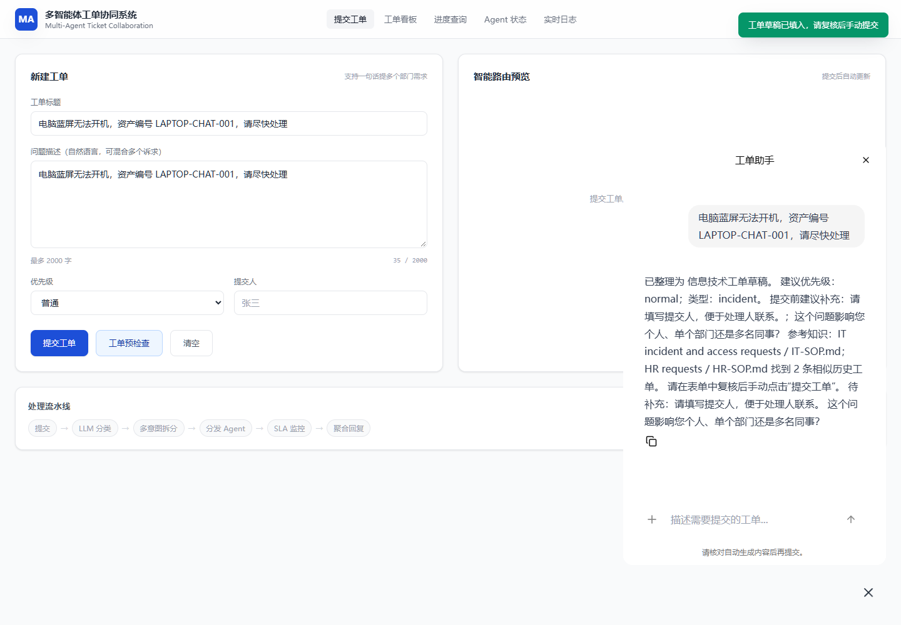
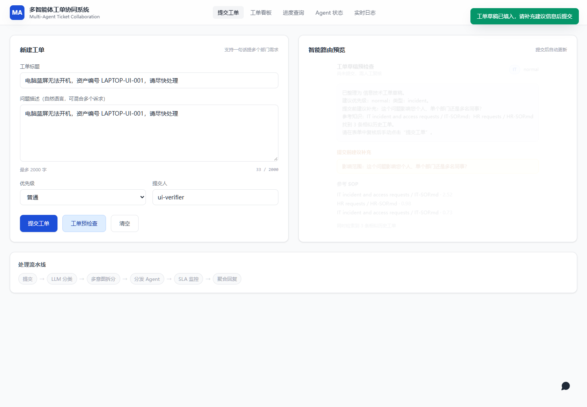
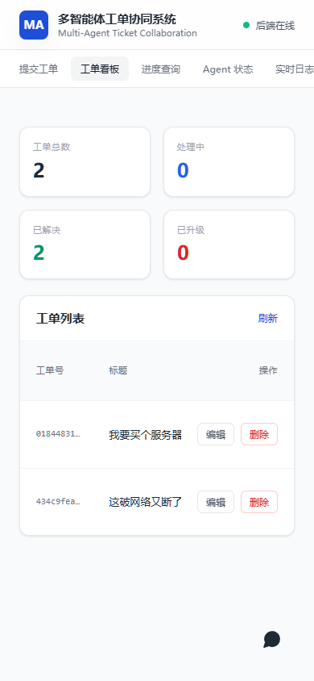
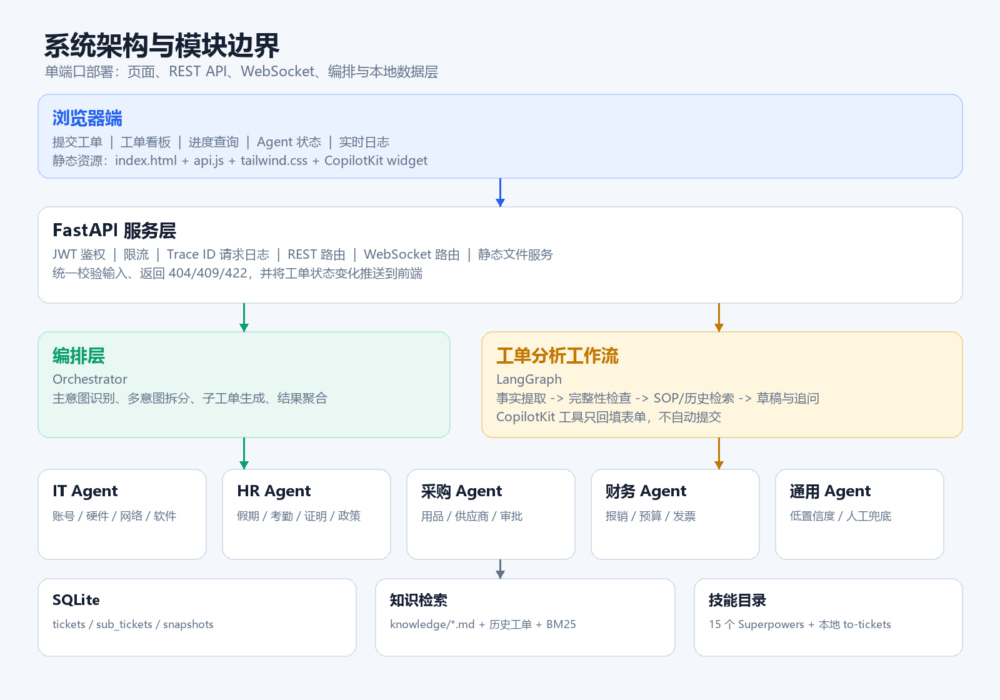
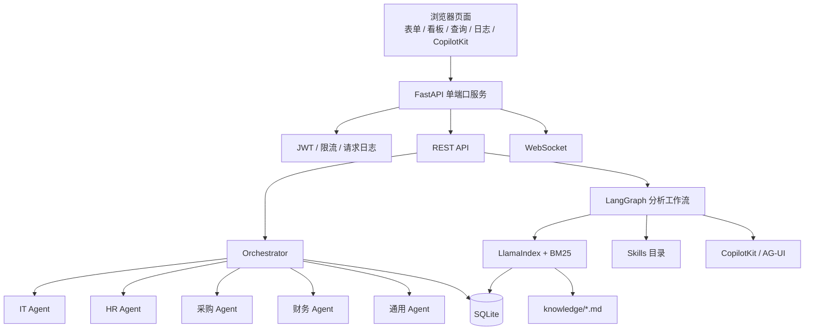
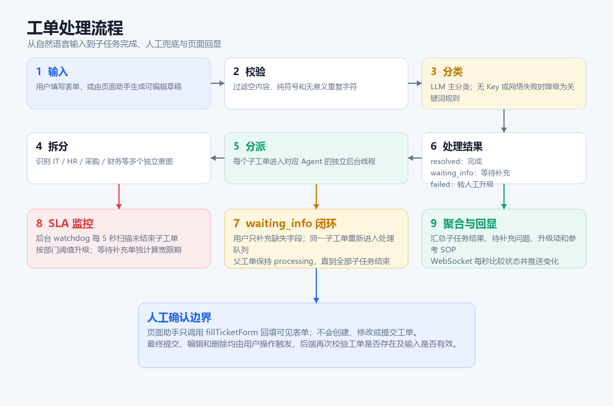

# 多智能体工单协同系统

面向多部门协作场景的工单管理平台。后端使用 FastAPI，前端使用原生 HTML/JavaScript，工单按部门拆分给独立 Agent 处理，并通过 LangGraph、CopilotKit、LlamaIndex 和 BM25 提供可复核的草稿生成、完整性检查与知识检索。

系统强调“可演示、可解释、可回退”：没有外部模型密钥时仍可依靠关键词规则运行；页面助手只能回填表单，最终提交、编辑和删除始终由用户操作。



## 项目亮点

- 工单完整 CRUD：创建、列表、详情、编辑、删除。
- 一句话多意图拆分：一个父工单可以生成 IT、HR、采购、财务等多个子工单。
- 独立 Agent 处理：每个部门拥有自己的二级意图规则、结果结构和缺失信息检查。
- 人工确认边界：页面助手只调用 `fillTicketForm`，不会自动创建或提交工单。
- 可降级分类：优先调用兼容 OpenAI 协议的模型，失败时自动切换关键词分类。
- 本地知识检索：检索 `knowledge/*.md` 与历史工单，返回 SOP 建议和相似工单。
- 实时状态同步：浏览器通过 WebSocket 获取父工单、子工单和状态迁移。
- SLA 自动升级：后台 watchdog 定时扫描未完成子工单，按部门阈值升级。
- 离线静态资源：Tailwind 和 CopilotKit 前端资源均已预构建，目标电脑不需要 Node.js。
- 单端口部署：FastAPI 同时提供 API、WebSocket 和前端页面。

## 页面展示

### 提交工单与页面助手

页面助手读取当前表单内容，生成可编辑草稿，并提示提交前需要补充的信息。


### 工单看板

工单看板提供状态统计、子任务数量、优先级、提交时间，以及每行的编辑和删除入口。



### 移动端

移动端保留完整导航、工单列表和操作按钮。

<p align="center">
  
</p>

## 系统架构





## 工单处理流程



1. 用户填写标题、描述、优先级和提交人。
2. 后端过滤空内容、纯符号和无意义重复文本。
3. `classify_with_fallback` 优先调用模型识别多意图；无密钥或调用失败时使用关键词分类。
4. Orchestrator 创建父工单，并按照部门生成独立子工单。
5. 每个子工单进入对应 Agent 的后台线程。
6. Agent 返回完成结果，或进入 `waiting_info` 请求补充信息。
7. 用户通过 `append-info` 只补充当前子工单所需字段，任务重新进入处理队列。
8. SLA watchdog 每 5 秒扫描未终止子工单，超时后升级为人工处理。
9. 所有子任务结束后聚合结果，并通过 WebSocket 推送到页面。

## 多 Agent 设计

| 组件 | 主要职责 | 关键实现 |
| --- | --- | --- |
| Orchestrator | 分类、多意图拆分、子工单创建、结果聚合 | `backend/app/agents/orchestrator.py` |
| IT Agent | 账号、硬件、网络、软件请求 | `backend/app/agents/it_agent.py` |
| HR Agent | 假期、考勤、证明、政策查询 | `backend/app/agents/hr_agent.py` |
| Procurement Agent | 办公用品、供应商、采购审批 | `backend/app/agents/procurement_agent.py` |
| Finance Agent | 报销、预算、发票处理 | `backend/app/agents/finance_agent.py` |
| General Agent | 低置信度请求、无效输入、人工兜底 | `backend/app/agents/general_agent.py` |
| Agent Registry | 注册 Agent、后台线程分派、SLA watchdog 生命周期 | `backend/app/agents/registry.py` |

每个 Agent 都继承 `BaseAgent`，统一实现：

```text
created -> processing -> resolved
                      -> waiting_info -> processing -> resolved
                      -> escalated
```

父工单不会因为某一个子任务完成就提前结束。只有当全部子任务进入终态后，父工单才会更新为 `resolved` 或 `escalated`。

## 任务板块分布

### 前端板块

| 板块 | 功能 | 对应位置 |
| --- | --- | --- |
| 提交工单 | 新建工单、编辑工单、工单草稿预检查 | `frontend/index.html` 提交面板 |
| 工单看板 | 状态统计、工单列表、编辑、删除 | `frontend/index.html` 看板面板 |
| 进度查询 | 查询父子工单、追加缺失信息 | `frontend/index.html` 详情面板 |
| Agent 状态 | 展示各部门 Agent 在线状态和处理量 | `/api/v1/agents` |
| 实时日志 | 展示前端操作和状态迁移 | `frontend/index.html` 日志面板 |
| 页面助手 | 读取表单、生成草稿、工具回填 | `frontend/copilot-widget-src/src/index.jsx` |

### 后端板块

| 模块 | 作用 |
| --- | --- |
| `backend/app/api` | REST、WebSocket、鉴权与工单分析路由 |
| `backend/app/agents` | 多 Agent 编排与部门任务处理 |
| `backend/app/assistant` | LangGraph 分析流程与 BM25 检索 |
| `backend/app/state` | SQLite 持久化、快照和可选 Redis 镜像 |
| `backend/app/skills` | 安全扫描并读取 `SKILL.md` 元数据 |
| `backend/app/middleware` | JWT、限流、Trace ID 请求日志 |
| `backend/app/core` | 分类、回退规则、缺失字段检查、模型调用 |

## Skills

当前目录包含 16 个可发现技能：

- 15 个来自 `obra/superpowers` 的公开技能，固定提交为 `bb92a77741419a4ab5f06e711a283343f1ada0c3`。
- 1 个本地编写的 `to-tickets` 兼容技能，用于把自由文本整理为可复核工单草稿。

```text
skills/
├── local/to-tickets/SKILL.md
└── vendor/superpowers/skills/
```

工作流会读取技能元数据，并把 `to-tickets`、`brainstorming`、`systematic-debugging`、`verification-before-completion` 标记为当前分析阶段相关技能。实际的工单字段提取、缺失字段检查和人工确认逻辑位于 `backend/app/assistant/workflow.py`，不依赖运行外部脚本。

`mattpocock/to-tickets` 的原始地址在实现时无法公开访问，因此仓库内是明确标注的本地兼容实现，不是上游源码副本。完整来源和固定版本见 [skills/SOURCES.json](skills/SOURCES.json)。

## 页面助手实现

页面助手采用 CopilotKit v2 + LangGraph AG-UI：

- 前端通过 `useAgentContext` 读取当前可见表单。
- LangGraph 节点执行事实提取、完整性检查、SOP 检索和草稿整理。
- `fillTicketForm` 是唯一写前端表单的工具。
- 工具处理函数只派发 `ticket-assistant:fill` 事件。
- 提交按钮、编辑按钮和删除按钮不会由助手触发。
- 后端 `/api/v1/copilot/analyze` 只生成草稿，不写入数据库。

预构建文件：

```text
frontend/copilot-widget.js
frontend/copilot-widget.css
```

`frontend/copilot-widget-src/` 仅在开发时用于重新构建，普通用户运行系统不需要 Node.js。

## 数据模型

默认数据库为：

```text
backend/data/tickets.sqlite3
```

| 表 | 说明 |
| --- | --- |
| `tickets` | 父工单、分类结果、状态、优先级和元数据 |
| `sub_tickets` | 部门子工单、二级意图、处理结果和 SLA 状态 |
| `snapshots` | 工单数据变更快照，用于追踪和诊断 |

SQLite 使用 WAL 模式和进程内锁。`version` 字段用于乐观锁，更新时可以让调用方传入期望版本。Redis 是可选镜像，不是默认运行依赖。

## API

业务接口统一以 `/api/v1` 为前缀。除健康检查、演示 Token 和 CopilotKit 握手外，请求需要：

```http
Authorization: Bearer <JWT>
```

| 方法 | 路径 | 作用 |
| --- | --- | --- |
| POST | `/api/v1/auth/token` | 签发演示 JWT |
| POST | `/api/v1/tickets/submit` | 新建并自动路由工单 |
| GET | `/api/v1/tickets` | 查询工单列表 |
| GET | `/api/v1/tickets/{id}` | 查询单个工单 |
| PATCH | `/api/v1/tickets/{id}` | 修改标题、描述、提交人、优先级 |
| DELETE | `/api/v1/tickets/{id}` | 删除工单、子工单和快照；不存在返回 404 |
| GET | `/api/v1/tickets/{id}/sub-tickets` | 查询子工单 |
| GET | `/api/v1/tickets/{id}/result` | 查询聚合结果 |
| POST | `/api/v1/tickets/{id}/sub-tickets/{sub_id}/append-info` | 补充缺失信息 |
| WS | `/api/v1/tickets/{id}/stream?token=...` | 订阅状态变化 |
| GET | `/api/v1/agents` | 查询 Agent 状态 |
| GET | `/api/v1/agents/{type}/status` | 查询单个 Agent 状态 |
| POST | `/api/v1/copilot/analyze` | 生成表单草稿，不落库 |
| GET | `/api/v1/copilot/skills` | 查询技能目录 |
| GET/POST | `/api/v1/copilotkit/info` | CopilotKit v2 运行时握手 |
| POST | `/api/v1/copilotkit/agent/ticket_assistant/run` | LangGraph AG-UI 对话与工具调用 |
| GET | `/health` | 健康检查 |

启动后可访问 Swagger：

```text
http://127.0.0.1:8000/docs
```

## 技术栈

| 层级 | 技术 |
| --- | --- |
| 后端 | Python 3.10+、FastAPI、Pydantic |
| 状态存储 | SQLite WAL、可选 Redis |
| 工作流 | LangGraph、LangChain Core |
| 页面助手 | CopilotKit v2、AG-UI、React 预构建组件 |
| 检索 | LlamaIndex Core、BM25S |
| 前端 | 原生 HTML/JavaScript、Tailwind 预构建 CSS |
| 鉴权 | JWT HS256 |
| 测试 | pytest、Playwright |

## 本地启动

### 一键启动

1. 安装 Python 3.10+，并勾选 `Add Python to PATH`。
2. 双击 `安装依赖.bat`。
3. 双击 `一键启动.bat`。
4. 浏览器访问 `http://127.0.0.1:8000/?tab=dashboard`。

只检查环境：

```bat
安装依赖.bat --verify
```

启动但不自动打开浏览器：

```bat
一键启动.bat --no-browser
```

停止服务：

```bat
停止服务.bat
停止服务.bat --port 8001
```

### 手动启动

```powershell
cd backend
.\.venv\Scripts\python.exe serve.py --host 127.0.0.1 --port 8000
```

第一次安装依赖需要联网。运行项目不需要 Node.js，也不需要 Visual C++ Build Tools。

## 模型配置

模型调用兼容 OpenAI Chat Completions 协议。复制 `.env.example` 后填写：

```powershell
$env:AGENT_LLM_ENABLED = "true"
$env:AGENT_LLM_API_KEY = "sk-..."
$env:AGENT_LLM_BASE_URL = "https://api.sapiens.ai/v1"
$env:AGENT_LLM_MODEL = "agnes-3-flash"
```

没有 API Key 时，可显式关闭模型调用：

```powershell
$env:AGENT_LLM_ENABLED = "0"
```

此时分类、缺失字段检查和检索仍可运行。

## 数据与安全

- 所有工单输入经过长度、空值和无效字符检查。
- `PATCH` 拒绝 `null` 和空标题，且至少需要一个更新字段。
- `DELETE` 先检查父工单是否存在，不存在返回 `404`。
- 删除父工单时同步删除 `sub_tickets` 和 `snapshots`。
- WebSocket 使用 JWT 查询参数校验，缺少或无效 Token 会以 `1008` 关闭。
- 请求日志带 `X-Trace-Id`，便于定位单次调用。
- 默认 JWT 密钥仅用于本地开发，部署前必须通过 `AGENT_JWT_SECRET` 覆盖。
- `.env`、SQLite 数据、日志、虚拟环境和 `node_modules` 已被 `.gitignore` 排除。

## 测试

```powershell
cd backend
$env:AGENT_LLM_ENABLED = "0"
$env:AGENT_SQLITE_PATH = "data\test_tickets.sqlite3"
.\.venv\Scripts\python.exe -m pytest tests -q
```

当前后端测试覆盖：

- 健康检查与 JWT 鉴权。
- 工单创建、查询、更新、删除和 404。
- 父工单与子工单清理。
- 多意图提交与 Agent 状态。
- CopilotKit 握手、草稿不落库、技能发现。
- AG-UI `fillTicketForm` 工具调用。
- 采购 Agent 条件判断、UTC SLA 解析。
- WebSocket 未授权关闭。

静态检查：

```powershell
cd backend
.\.venv\Scripts\ruff.exe check app tests
```

浏览器回归：

```powershell
cd frontend/copilot-widget-src
node verify-ui.mjs
node verify-copilot-chat.mjs
```

浏览器回归测试只在开发环境需要 Node.js。

## 目录结构

```text
.
├── backend/
│   ├── app/
│   │   ├── agents/          # 编排器与部门 Agent
│   │   ├── api/             # REST 和 WebSocket 路由
│   │   ├── assistant/       # LangGraph 与 BM25 检索
│   │   ├── core/            # 分类、回退与缺失字段规则
│   │   ├── middleware/      # JWT、限流、请求日志
│   │   ├── skills/          # SKILL.md 安全发现
│   │   ├── state/           # SQLite 持久化
│   │   └── main.py          # FastAPI 应用工厂
│   ├── tests/
│   ├── requirements.txt
│   └── serve.py             # API 与前端单端口启动器
├── frontend/
│   ├── copilot-widget-src/  # CopilotKit 开发源码
│   ├── index.html
│   ├── api.js
│   ├── tailwind.input.css
│   ├── tailwind.config.js
│   ├── tailwind.css         # 预构建
│   ├── copilot-widget.css    # 预构建
│   └── copilot-widget.js     # 预构建
├── knowledge/                # SOP 文档
├── skills/                   # Superpowers 与本地技能
├── docs/                     # 截图、架构图和说明文档
├── scripts/                  # 文档图片生成脚本
├── 安装依赖.bat
├── 一键启动.bat
└── 停止服务.bat
```

## 设计边界

这个项目定位为可运行的本地完整实现，不是已经接入真实企业系统的生产集群：

- 工单数据当前使用 SQLite，没有迁移 MySQL。
- IT 资产、HR 余额、采购库存和财务审批使用本地演示数据。
- Agent 使用进程内后台线程，没有接入 RabbitMQ、Kafka 等消息队列。
- `/auth/token` 是演示接口，生产环境应替换为用户目录或 OIDC。
- 模型调用是可选项，关键词规则是离线回退路径。
- 技能目录负责发现和展示 `SKILL.md` 元数据；实际工单字段规则仍由项目代码显式控制。

## 第三方来源

- Superpowers: <https://github.com/obra/superpowers>
- CopilotKit: <https://github.com/CopilotKit/CopilotKit>
- LangGraph: <https://github.com/langchain-ai/langgraph>
- LlamaIndex: <https://github.com/run-llama/llama_index>
- Superpowers 许可证: `skills/vendor/superpowers/LICENSE`
- 完整依赖与固定版本: `skills/SOURCES.json`、`backend/requirements.txt`、`frontend/copilot-widget-src/package.json`
